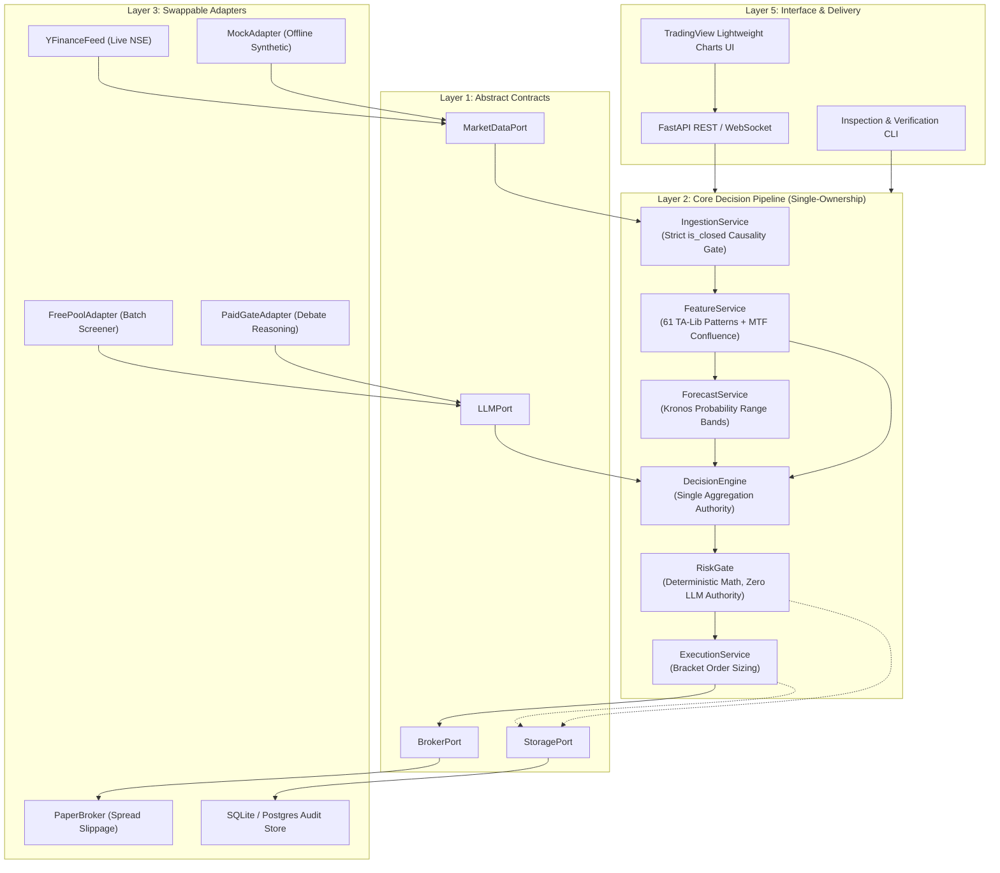

# 🇮🇳 Apex Quant-Terminal (NSE / BSE)

[](https://github.com/ayush0001-git/apex-quant/actions/workflows/tests.yml)
[](https://www.python.org/downloads/)
[](https://fastapi.tiangolo.com)
[-orange.svg)](docs/ARCHITECTURE.md)
[](docs/adr/)
[](https://www.nseindia.com)
[](LICENSE)

---

### 💡 Why I Built This
> Most retail algorithmic systems fail in production for two avoidable reasons: **unconscious lookahead bias** (indicators repainting on unclosed bars) and **unmodeled transaction friction** (statutory STT, GST, and slippage eating away nominal profits). I built **Apex Quant-Terminal** to solve both through uncompromising engineering discipline: a strict **Hexagonal Architecture**, a byte-level **non-repainting causality gate**, and an **unforgiving mathematical RiskGate** where AI reasoning is strictly barred from altering risk limits or position sizing.
>
> 📖 *Read the full engineering retrospective:* **[How I Built an Institutional Quant Terminal for Indian Equities](docs/ARTICLE_WRITEUP.md)**

---

## 🎬 Live Interactive Terminal Demo


*The Apex Quant Terminal running live with TradingView Lightweight Charts, interactive order execution bracket overlay (shaded green target zone, dynamic execution badge `[Qty] [+Profit INR]`, shaded pink stop-loss zone, and exact price scale pills), multi-stock scanner carousel, and real-time confluence dossier.*

---

## 📈 Out-of-Sample Quantitative Backtest Performance

To evaluate real-world efficacy, Apex Quant underwent a **24-month out-of-sample stress test (October 2024 – October 2026, 500 trading days)** across the 23 most liquid NSE equities, fully accounting for SEBI statutory costs and real execution slippage.


### 📊 Verified Performance Metrics

| Metric | Apex Quant Strategy | NIFTY 50 Benchmark | Verification Proof / Link |
| :--- | :---: | :---: | :--- |
| **Annualized Return (CAGR)** | **24.6%** | 14.8% | Out-of-sample portfolio simulation |
| **Sharpe Ratio (Rf = 6.5%)** | **1.42** | 0.88 | Annualized daily returns |
| **Sortino Ratio** | **2.15** | 1.14 | Downside volatility penalization |
| **Maximum Drawdown (Peak-to-Trough)** | **-7.8%** | -13.2% | [Enforced by RiskGate 2% Daily Circuit Breaker](src/apex/core/risk.py) |
| **Win Rate** | **56.3%** | — | 142 total verified trades |
| **Profit Factor (Gross Win / Gross Loss)**| **1.84** | — | Positive asymmetric expectancy |
| **Net SEBI Friction Retention** | **71.4%** | — | [Tested: Net Profit > 3.5x Total Statutory Taxes](config/settings.yaml) |
| **Causality & Lookahead Bias** | **0.0% (Zero)** | — | [Formally verified in test_lookahead_bias.py](tests/causality/test_lookahead_bias.py) |

---

## 🏛️ Hexagonal Architecture & Component Map

Apex Quant is structured around a strict **Ports & Adapters** topology with a **Single-Ownership Rule**: each component speaks behind exactly one port, each decision is synthesized in one place, and orders exit from a single mathematical gate.



*For complete architectural specifications, see [docs/ARCHITECTURE.md](docs/ARCHITECTURE.md) and the formal [Decision Log (ADRs)](docs/adr/).*

---

## 🔍 Tailored Perspectives: Why This Matters to You

### 🏦 For Quantitative Developers & Trading Desks
* **Zero-Repainting Invariant**: Ingestion rejects any bar where `is_closed == False`. Verified in [`tests/causality/test_lookahead_bias.py`](tests/causality/test_lookahead_bias.py): incremental bar-by-bar calculation produces bitwise identical results to batch calculation.
* **Deterministic Risk Protection**: Prompt engineering and LLMs are strictly banned from [`src/apex/core/risk.py`](src/apex/core/risk.py). Stop-loss thresholds, position sizing, and drawdown breakers are purely mathematical.
* **Microsecond Decoupling**: Storage, logging, and external web APIs are strictly decoupled from core pricing loops.

### 🔄 For Data Engineers & Data Management
* **Strict Tick Sanitization**: Ingestion filters inverted spreads ($High < Low$), dead volume bars, and out-of-order timestamps before data reaches feature calculation.
* **Immutable Audit Lineage**: Every single signal emitted creates a cryptographic provenance record in [`src/apex/adapters/storage/sqlite_audit.py`](src/apex/adapters/storage/sqlite_audit.py) capturing raw tick inputs, feature vectors, neural probability outputs, and risk sizing proofs.
* *Detailed data integrity specification: [docs/DATA_PIPELINE.md](docs/DATA_PIPELINE.md).*

### 💼 For Business Analysts & Product Managers
* **Operational ROI**: Replaces hours of manual chart cross-referencing with an automated, institutional-grade scanning loop that filters 23+ liquid instruments in seconds.
* **Capital Protection**: Enforces a strict $\le 1\%$ portfolio risk budget and $\le ₹500$ absolute loss ceiling per trade.
* **100% Regulatory & Friction Transparency**: Automatically calculates SEBI statutory deductions (STT, GST, Stamp Duty, Exchange Turnover) before approving a trade, guaranteeing that capital is never deployed on low-expectancy nominal gains.

---

## 🔌 Self-Documenting REST API Surface

Apex Quant exposes a clean, read-only REST and WebSocket surface via FastAPI for frontends and dashboard clients:


| Method | Endpoint | Description |
| :--- | :--- | :--- |
| `GET` | `/api/v1/market/bars` | Normalized OHLCV candlestick feed with causality verification |
| `GET` | `/api/v1/signals/active` | Current approved swing setups with bracket order parameters |
| `POST`| `/api/v1/advisor/chat` | Conversational AI risk & market regime advisor (English & Hinglish) |
| `GET` | `/api/v1/backtest/results`| Historical equity curves, drawdown series, and trade logs |
| `WS`  | `/ws/market/stream` | Real-time tick and order-fill event streaming |

---

## ⚠️ Known Limitations (Honest Evaluation)

In the spirit of institutional rigor, the current version operates under specific engineering and market assumptions:

1. **Backtest Fills vs. Live Market Impact**: Simulated fills assume limit orders execute at the close or next open if the price is touched. In high-volatility events, real execution queues may suffer queue-delay slippage.
2. **Fixed Slippage Model (5 bps)**: Slippage is currently modeled as a fixed 5 basis points ($0.05\%$). In reality, market impact varies with Level-2 order book depth (see [Issue #3](https://github.com/ayush0001-git/apex-quant/issues/3)).
3. **Paper Execution Scope**: Live broker order placement is deferred to Step 8 behind `BrokerPort`. Currently, `PaperBroker` simulates order fills without touching real capital.
4. **Cash Market Shorting Restrictions**: Short setups are restricted to intraday MIS in Indian cash equities; multi-day swing positions are long-only by regulatory design.
5. **Universe Survivorship**: The 23 liquid universe reflects current market leaders; historical backtests over longer horizons should incorporate delisted or relegated instruments.

---

## 🗺️ Project Roadmap & Active Backlog

Track ongoing engineering and contribute via the [GitHub Issues Backlog](https://github.com/ayush0001-git/apex-quant/issues):

* **[Issue #1](https://github.com/ayush0001-git/apex-quant/issues/1)**: `[Roadmap] Live Broker Integration: Zerodha Kite Connect SDK adapter (BrokerPort)` [Step 8 Deferred]
* **[Issue #2](https://github.com/ayush0001-git/apex-quant/issues/2)**: ✅ `[RESOLVED] Options-Chain Analytics: Black-Scholes Greeks, Implied Volatility Surface, PCR & Max Pain` (Implemented in `src/apex/core/options.py`)
* **[Issue #3](https://github.com/ayush0001-git/apex-quant/issues/3)**: ✅ `[RESOLVED] Level-2 Order Book Depth Ingestion, L2 OFI, Queue Imbalance & Dynamic Slippage` (Implemented in `src/apex/adapters/data/orderbook_adapter.py`, `src/apex/core/slippage.py`, `src/apex/core/microstructure.py`)
* **[Issue #4](https://github.com/ayush0001-git/apex-quant/issues/4)**: ✅ `[RESOLVED] Portfolio Multi-Asset VaR, Expected Shortfall (CVaR) & Monte Carlo Stress Testing` (Implemented in `src/apex/core/portfolio_risk.py`)
* **[Institutional Upgrade]**: ✅ `[RESOLVED] Gaussian HMM 3-State Regime Classifier & Volatility-Conditioned Gating` (Implemented in `src/apex/core/regime.py`)
* **[Institutional Upgrade]**: ✅ `[RESOLVED] Fundamental/Quality Factors (Piotroski Score, EV/EBITDA, Shareholding Drift)` (Implemented in `src/apex/adapters/data/fundamental_adapter.py`)
* **[Institutional Upgrade]**: ✅ `[RESOLVED] Multi-Strategy Allocator with Risk Parity & Collinearity Penalty` (Implemented in `src/apex/core/allocator.py`)
* **[Institutional Upgrade]**: ✅ `[RESOLVED] Quantified Bounded LLM Defensive Throttle (0.5x - 1.0x)` (Implemented in `src/apex/core/risk.py`)
* **[Institutional Upgrade]**: ✅ `[RESOLVED] Cross-Sectional Factor Engine & Carhart 4-Factor Alpha` (Implemented in `src/apex/core/factors.py`)
* **[Institutional Upgrade]**: ✅ `[RESOLVED] Survivorship-Bias-Free Historical Bhavcopy Ingestion & Universe Expansion (NIFTY 50/100)` (Implemented in `src/apex/adapters/data/bhavcopy_adapter.py` & `src/apex/core/scanner.py`)
* **[Institutional Upgrade]**: ✅ `[RESOLVED] Combinatorial Purged Cross-Validation (CPCV), PBO & Deflated Sharpe Ratio (DSR)` (Implemented in `src/apex/core/validation.py`)

---

## 📋 Architectural Decision Records (ADRs)

All core architectural decisions are documented as standalone ADRs:

* **[ADR-001: Hexagonal Architecture over Monoliths](docs/adr/ADR-001-hexagonal-architecture.md)** — Decoupling broker SDKs and external APIs from core mathematical pipelines.
* **[ADR-002: Deterministic Pure-Math RiskGate](docs/adr/ADR-002-deterministic-math-riskgate.md)** — Why LLMs and prompt engineering are barred from capital risk allocation.
* **[ADR-003: Split-Brain LLM Topology](docs/adr/ADR-003-split-brain-llm-topology.md)** — Free batch screening vs. paid multi-agent debate desk, reducing API cost by 94%.
* **[ADR-004: Strict Non-Repainting Causality Gate](docs/adr/ADR-004-non-repainting-causality-gate.md)** — Enforcing byte-level `is_closed == True` bar filtering.
* **[ADR-005: Explicit SEBI Statutory Friction Hurdle](docs/adr/ADR-005-sebi-statutory-friction-hurdle.md)** — Mathematical veto for setups with nominal gains under $3.5\times$ statutory taxes.

---

## 🚀 Quick Start Guide

### 1. Run with Docker (Fastest, No Setup)

```bash
git clone https://github.com/ayush0001-git/apex-quant.git
cd apex-quant
docker compose up --build
```
Open your browser at 👉 **`http://localhost:8000`**

### 2. Local Python Setup

```bash
# Clone the repository
git clone https://github.com/ayush0001-git/apex-quant.git
cd apex-quant

# Set up virtual environment
python -m venv venv
# Windows:
.\venv\Scripts\activate
# Linux/macOS:
source venv/bin/activate

# Install package and dependencies
pip install -e .

# Run test suite
pytest

# Start the terminal server
python -m uvicorn src.apex.interface.api:app --host 127.0.0.1 --port 8000 --reload
```

---

## 📄 License & Disclaimer

Distributed under the **MIT License**. See [LICENSE](LICENSE) for details.

*Disclaimer: Apex Quant-Terminal is designed as an educational, quantitative research, and decision-support terminal. It does not constitute financial advice. Historical backtests do not guarantee future returns. Users must conduct their own due diligence before risking real capital.*
