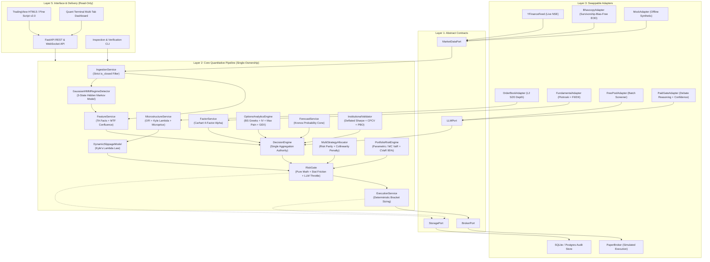

# 🏛️ Apex Quant-Terminal — Architecture Specification

## 1. Architectural Philosophy: The Single-Ownership Rule

> **"Let each component speak behind exactly one Port, let each decision be produced in exactly one place, and let orders exit from exactly one gate."**

To eliminate signal contradictions, "skill overlap," accidental backtest lookahead bias, and data snooping:
1. **Hexagonal Isolation (Ports & Adapters)**: The Core Decision Pipeline depends **only** on abstract interface contracts (`ports/`) and pure domain models (`domain/`). It has zero direct knowledge of concrete broker APIs, scrapers, or specific LLM libraries.
2. **Strictly Unidirectional Data Flow**: Each core stage consumes the output of the preceding stage and cannot call backward or bypass intermediate steps.
3. **Physical Source Directory Walls**: Dependencies in `core/` on any adapter or external network SDK are caught by static linting and tests, failing immediately.
4. **Deterministic RiskGate (Zero LLM)**: `RiskGate` is pure Python mathematics. Qualitative LLM reasoning belongs strictly inside `adapters/llm/` and cannot alter hard statutory boundaries, stop losses, or bypass risk filters.
5. **Private Non-Broker Scope**: Built as a private institutional advisory & decision-support terminal for Indian markets (NSE / BSE).

---

## 2. Institutional Architecture Map & Component Flow

---

## 3. Institutional Quantitative Pillars

### A. Dynamic Slippage & Market Impact (Kyle's Lambda Law)
Replaces naive static slippage assumptions with Kyle's square-root law:
$$\text{Impact} \sim \sigma \cdot \sqrt{\frac{\text{OrderSize}}{\text{ADV}}} + \text{BaseSlippage}$$
Execution slippage dynamically expands during volume spikes and volatility bursts.

### B. Cross-Sectional Factors (Carhart Four-Factor Model)
Computes Market Beta ($\beta$), Size (SMB), Value/Quality (HML / Piotroski F-Score), and Momentum (WML) across Indian equities, providing structural alpha independent of candlestick patterns.

### C. 3-State Gaussian Hidden Markov Model (HMM)
Models underlying latent market regimes:
- **State 0: Low-Volatility Bull Expansion** (Full 1.0x position sizing).
- **State 1: Range Compression / Transition** (0.8x conservative sizing).
- **State 2: High-Volatility Market Turbulence** (0.5x defensive throttle, demoting TA weight).

### D. Market Microstructure & Level-2 Order Book
Processes top-of-book and multi-level depth quotes:
- **Order Flow Imbalance (OFI)**: $\Delta B_t - \Delta A_t$ quantifying buyer vs seller initiative.
- **Queue Imbalance**: $(Q_{\text{bid}} - Q_{\text{ask}}) / (Q_{\text{bid}} + Q_{\text{ask}})$.
- **Microprice**: Volume-weighted fair mid-price estimator.

### E. Options Chain Analytics & Gamma Exposure (GEX)
- Black-Scholes analytical Greeks: Delta ($\Delta$), Gamma ($\Gamma$), Vega ($\nu$), Theta ($\Theta$), Rho ($\rho$).
- Newton-Raphson Implied Volatility (IV) solver.
- Put-Call Ratio (PCR) across Open Interest and Volume.
- Max Pain Strike minimizing total option buyer payout at weekly/monthly expiries.
- Net Market Maker Gamma Exposure (GEX) measuring hedging acceleration.

### F. Multi-Strategy Allocator (Risk Parity & Collinearity Penalties)
Blends three uncorrelated strategy streams (Trend-Following, Mean-Reversion, Factor Alpha) using inverse volatility weights ($w_i \propto 1/\sigma_i$) and penalizes collinear strategy streams ($\rho > 0.60$) to preserve true statistical degrees of freedom.

### G. Portfolio Risk, CVaR 95% & Historical Stress Testing
- 1-Day 95% and 99% Parametric and Historical Value-at-Risk (VaR).
- 95% Expected Shortfall (CVaR) evaluating extreme fat-tail risk.
- Monte Carlo simulations (Student-t fat-tail perturbations).
- 4 Macroeconomic Stress Scenarios:
  1. *2008 Global Financial Crisis*: -38% systemic shock, 250% volatility explosion.
  2. *2020 COVID Plunge*: -30% liquidity shock, extreme correlation spike.
  3. *2024 Election Day Volatility Spike*: -6% overnight gap shock.
  4. *Rate Hike / Liquidity Freeze*: Sector-specific credit contraction.

### H. Overfitting Diagnostics (Deflated Sharpe Ratio & PBO)
- Bailey & López de Prado's **Deflated Sharpe Ratio (DSR)** adjusting for selection bias and non-Gaussian returns.
- **Combinatorially Symmetric Cross-Validation (CSCV / CPCV)** evaluating the **Probability of Backtest Overfitting (PBO)**.

---

## 4. Layer Responsibility Matrix

| Layer | Physical Path | Strict Invariant | Testing Seam |
| :--- | :--- | :--- | :--- |
| **0: Domain** | `src/apex/domain/` | Zero external dependencies. Pure dataclasses, enums, orderbook contracts, configuration schemas. | `tests/unit/test_domain.py`, `tests/unit/test_orderbook.py` |
| **1: Ports** | `src/apex/ports/` | Abstract ABC interfaces defining input/output contracts. | `tests/contract/` |
| **2: Core** | `src/apex/core/` | Single-ownership quantitative pipeline. Zero network/IO. Pure Python + numpy/scipy/pandas/hmmlearn. | `tests/unit/` (77+ tests) |
| **3: Adapters** | `src/apex/adapters/` | Swappable concrete implementations (yfinance, bhavcopy, orderbook, fundamentals, paper broker, LLMs, SQLite). | Integration / Mocks |
| **4: Wiring** | `src/apex/wiring/` | Dependency injection container binding adapters to ports and assembling engines. | `tests/unit/test_api.py` |
| **5: Interface**| `src/apex/interface/` | Read-only delivery endpoints (REST, WebSocket, HTML5 Terminal). Cannot bypass RiskGate or place live unvetted orders. | `tests/unit/test_api.py` |
