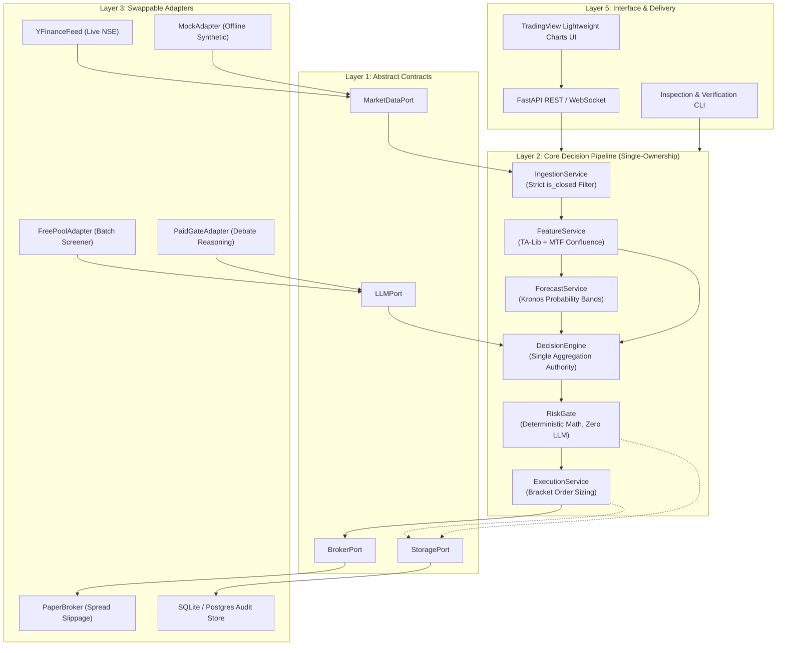

# 🏛️ Apex Quant-Terminal — Architecture Specification

## 1. Architectural Philosophy: The Single-Ownership Rule

> **"Let each component speak behind exactly one Port, let each decision be produced in exactly one place, and let orders exit from exactly one gate."**

To eliminate signal contradictions, "skill overlap," and accidental backtest lookahead bias:
1. **Hexagonal Isolation (Ports & Adapters)**: The Core Decision Pipeline depends **only** on abstract interface contracts (`ports/`) and pure domain models (`domain/`). It has zero direct knowledge of concrete broker APIs, scrapers, or specific LLM libraries.
2. **Strictly Unidirectional Data Flow**: Each core stage consumes the output of the preceding stage and cannot call backward or bypass intermediate steps.
3. **Physical Source Directory Walls**: A dependency in `core/` on any adapter or external network SDK is caught by static linting and rejected immediately.
4. **Deterministic RiskGate (Zero LLM)**: `RiskGate` is pure Python mathematics. Prompt engineering and qualitative reasoning belong strictly inside `adapters/llm/` and cannot alter position sizing or risk boundaries.
5. **Private Non-Broker Scope**: Built as a private advisory & decision-support terminal. Broker execution is decoupled behind `BrokerPort`.

---

## 2. Hexagonal Component Map & Sequence Flow

---

## 3. Strict Non-Repainting Ingestion Causality

In real-world quantitative systems, lookahead bias frequently leaks through unclosed candles or repainting indicators. Apex Quant enforces causality at the byte level:

* **Unclosed Bar Filter**: Any tick or bar where `is_closed == False` is rejected by `IngestionService` with an immediate validation exception.
* **Non-Repainting Invariant**: In `tests/causality/test_lookahead_bias.py`, we assert that calculating indicators incrementally bar-by-bar produces bitwise-identical results to running batch calculations over the entire history.
* **Volume Anomaly Rejection**: Bars with dead volume or inverted spreads ($High < Low$) are quarantined before reaching the Feature layer.

---

## 4. Layer Responsibility Matrix

| Layer | Physical Path | Strict Invariant | Testing Seam |
| :--- | :--- | :--- | :--- |
| **0: Domain** | `src/apex/domain/` | Zero external imports. Pure dataclasses, enums, and typed configuration schemas. | `tests/unit/test_domain.py` |
| **1: Ports** | `src/apex/ports/` | Abstract ABC interfaces defining input/output contracts. | `tests/contract/` |
| **2: Core** | `src/apex/core/` | Single-ownership decision pipeline. Zero network/IO code. Pure Python. | `tests/unit/` |
| **3: Adapters** | `src/apex/adapters/` | Swappable concrete implementations (yfinance, paper broker, LLMs, SQLite). | Integration / Mocks |
| **4: Wiring** | `src/apex/wiring/` | Dependency injection container binding adapters to ports. | `tests/unit/test_api.py` |
| **5: Interface**| `src/apex/interface/` | Read-only delivery endpoints (REST, WebSocket, HTML5 Terminal). Cannot trigger orders. | `tests/unit/test_api.py` |
