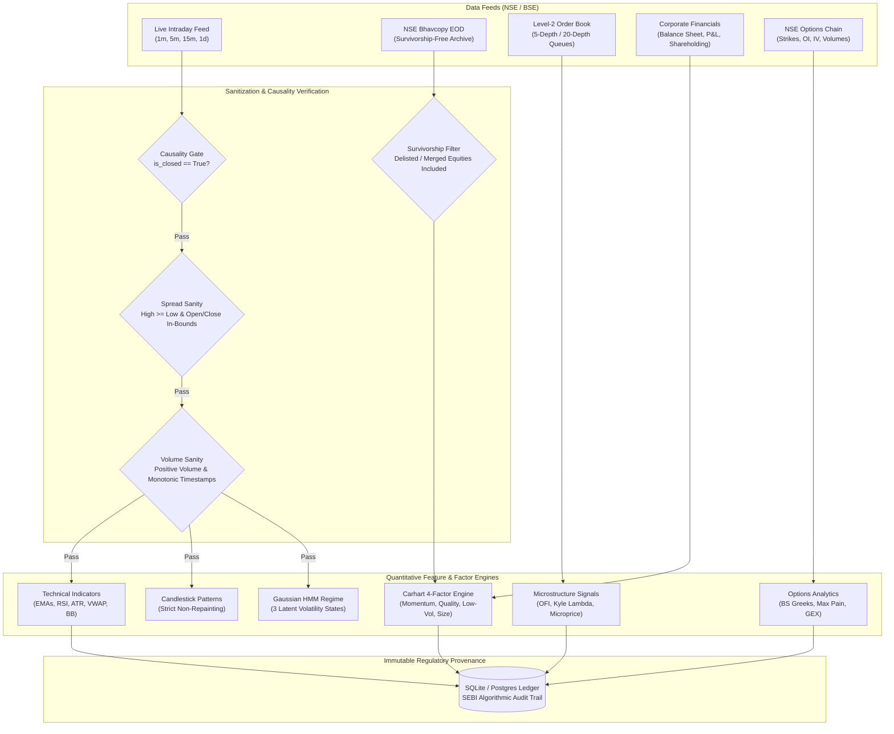

# 🔄 Data Management, Lineage & Quality Pipeline

In institutional quantitative finance, data integrity is paramount. Apex Quant-Terminal implements strict validation gates, survivorship bias elimination, Level-2 depth streaming, fundamental ingestion, and immutable audit persistence.

---

## 1. Unified Multi-Source Ingestion Pipeline

---

## 2. Validation Gates & Invariants

1. **Strict Non-Repainting Ingestion Causality**:
   - Every tick or candle where `is_closed == False` is rejected immediately with `DataQualityError`.
   - Batch feature extraction matches incremental bar-by-bar step evaluation bitwise with zero lookahead bias.
2. **Spread & Wick Sanity**:
   - Asserts $High \ge Open$, $High \ge Close$, $Low \le Open$, and $Low \le Close$. Inverted spreads trigger quarantine.
3. **Dead Volume & Gap Anomaly Rejection**:
   - Drops non-trading artifacts or zero-volume bars occurring during open exchange market hours.
4. **Timestamp Monotonicity**:
   - Requires strictly ascending UTC/IST timestamps; out-of-order ticks are rejected.

---

## 3. Specialized Data Pipelines

### A. NSE Bhavcopy & Survivorship-Bias-Free Engine (`bhavcopy_adapter.py`)
- Ingests official National Stock Exchange of India (NSE) Bhavcopy CSV archives.
- Maintains point-in-time constituent history for NIFTY 50, NIFTY Next 50, and NIFTY 100.
- Preserves historical delisted, merged, and acquired securities (eliminating survivorship bias).
- Computes unadjusted and corporate-action adjusted closing prices.

### B. Level-2 Order Book Depth Stream (`orderbook_adapter.py`)
- Normalizes NSE Level-2 5-depth and 20-depth order book snapshots.
- Tracks discrete bid/ask queues, order counts, and queue depth.
- Computes top-of-book and multi-level Order Flow Imbalance (OFI), queue imbalances, and volume-weighted microprice.

### C. Fundamental & Shareholding Pipeline (`fundamental_adapter.py`)
- Ingests quarterly balance sheets, P&L statements, and institutional shareholding patterns.
- Computes the **Piotroski 9-Point F-Score** assessing profitability, leverage/liquidity, and operating efficiency.
- Monitors quarterly FII/DII shareholding drift and promoter pledging.
- Produces normalized Quality Composite scores [0.0 to 100.0].

### D. Derivatives & Options Chain Analytics (`options.py`)
- Analyzes weekly and monthly NSE equity/index option chains.
- Black-Scholes analytical Greeks: Delta ($\Delta$), Gamma ($\Gamma$), Vega ($\nu$), Theta ($\Theta$), Rho ($\rho$).
- Newton-Raphson Implied Volatility (IV) solver with Brent's fallback.
- Computes Put-Call Ratio (PCR) across Volume and Open Interest.
- Calculates Max Pain Strike and Market Maker Net Gamma Exposure (GEX).

---

## 4. SEBI Regulatory Audit Trail & Provenance Seal

Every trade recommendation and risk decision generated by Apex Quant is cryptographically sealed and written to the SQLite audit ledger (`sqlite_audit.py`):
- **Input Data State**: Full bar snapshot, timestamps, and order book depth evaluated.
- **Factor & Feature Vector**: Indicators, candlestick patterns, HMM state probabilities, and factor exposures.
- **LLM Multi-Agent Breakdown**: Bull/Bear debate transcript, synthetic consensus, and quantified confidence score $[-1.0, 1.0]$.
- **Deterministic Risk Proof**: Calculated position size, stop loss, hurdle R:R ratio, statutory friction breakdown, and Kyle's lambda dynamic slippage quote.
- **Immutable Timestamp & Audit ID**: Fully compliant with SEBI circulars on algorithmic trading audit trails.
