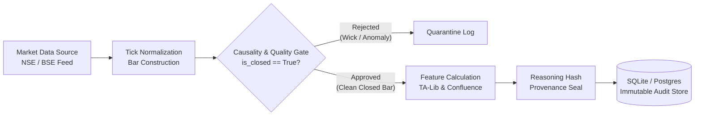

# 🔄 Data Management, Lineage & Quality Pipeline

In high-stakes quantitative finance, data integrity is paramount. Apex Quant-Terminal implements strict validation gates, lineage tracking, and audit persistence.

---

## 1. Data Ingestion & Sanitization Pipeline

### Validation Gates:
1. **Zero Unclosed Wicks**: Ingestion discards incomplete bars where `is_closed == False`.
2. **Spread Sanity**: Verifies $High \ge Open$, $High \ge Close$, $Low \le Open$, and $Low \le Close$. Inverted spreads trigger immediate quarantine.
3. **Dead Volume Detection**: Flags and drops ticks with zero traded volume during active exchange market hours.
4. **Timestamp Monotonicity**: Asserts strictly ascending bar timestamps; out-of-order ticks are rejected.

---

## 2. Feature Lineage & Audit Trail

Every trade recommendation generated by Apex Quant is accompanied by a cryptographic provenance snapshot stored in `StoragePort` (`sqlite_audit.py`):

* **Input Data Snapshot**: Exact open, high, low, close, volume series evaluated.
* **Feature Vector**: Exact values of 20 EMA, 50 MA, RSI(14), and identified candlestick patterns.
* **Forecast Distribution**: Probabilistic Kronos prediction bands.
* **Agent Debate Log**: Sanitized transcript of technical and risk agent debate.
* **Mathematical Risk Proof**: Calculated stop loss, position size, and statutory friction deduction.

This ensures **100% regulatory traceability and post-trade forensic replayability**.
